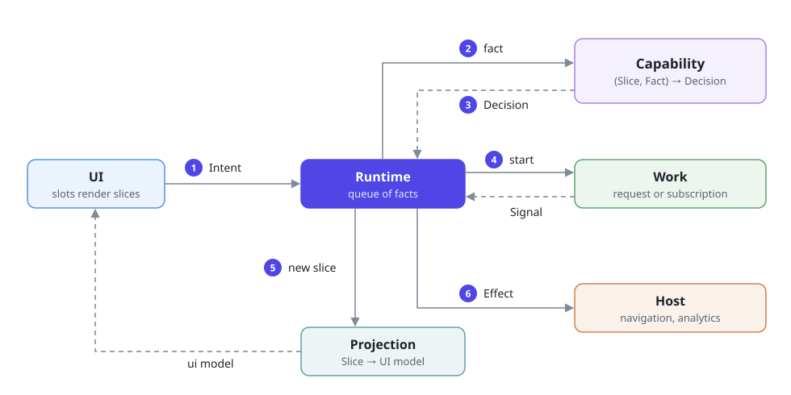
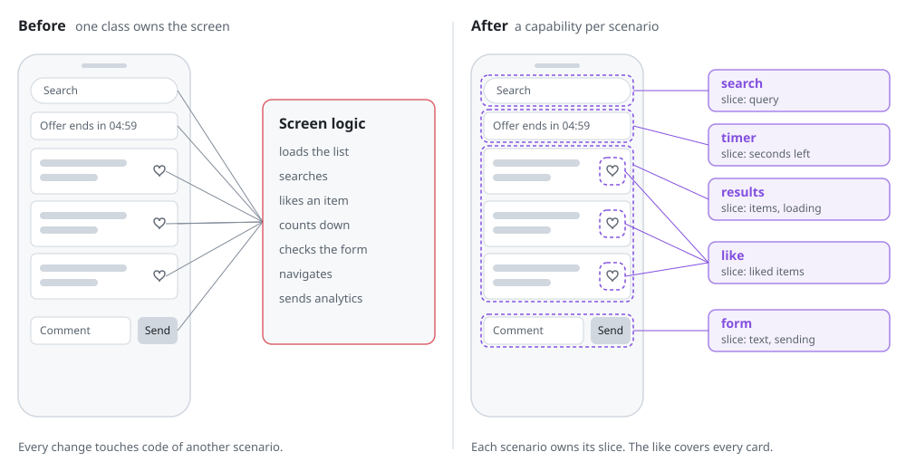

# 🍰 Capability Slice Architecture

<p align="center">
  <a href="LICENSE"></a>
  
  <a href="https://github.com/MairwunNx/Capsa"></a>
  
</p>

🍰 **Capability Slice Architecture** (CSA) — архитектура клиентских приложений с декларативным UI: Compose, Compose Multiplatform, SwiftUI, Avalonia.FuncUI. Вы режете экран на маленькие capability, по одной на пользовательский сценарий, и каждая владеет своим slice состояния.

[English version](README.md)

Факт попадает в runtime, capability решает, что он значит для её slice, а остальное делает runtime: сохраняет новый slice, запускает работу и отдаёт эффекты хосту.

<picture>
  <source media="(prefers-color-scheme: dark)" srcset="docs/images/flow-dark.svg">
  
</picture>

Экран перестаёт быть одним большим классом. Каждый сценарий становится своей capability со своим slice, а UI рисует эти slice рядом.

<picture>
  <source media="(prefers-color-scheme: dark)" srcset="docs/images/screen-split-dark.svg">
  
</picture>

> [!NOTE]
> CSA 0.99 — превью спецификации. До 1.0 имена и правила ещё могут измениться, и ваши отзывы на них влияют.

## Что вы получаете

- ✏️ **Сценарий меняется в одном месте.** Лайк, поиск и таймер живут каждый в своей capability, поэтому правка одного не задевает код другого.
- ⏳ **Асинхронность описана данными и отменяется сама.** Capability возвращает работу с ключом и политикой. Runtime запускает её, отменяет устаревший запрос при втором нажатии и отбрасывает его запоздалый ответ.
- 🚪 **Побочные эффекты выходят через одну дверь.** Навигация, снекбары и аналитика покидают логику как эффекты, и исполняет их только хост.
- 🧪 **Логика тестируется без UI.** Capability — чистая функция от slice и факта. Тест отправляет факты и проверяет slice и эффекты: без эмулятора и без моков фреймворка.
- 🛡️ **Новый факт не ломает соседний сценарий.** Каждая capability объявляет, какие факты она обрабатывает, а остальные runtime ей не доставляет.
- 🤖 **Агенты следуют правилам.** Правила короткие и формальные, поэтому ИИ-агент пишет capability, которая им соответствует, а ревью проверяет её по пунктам.

## Пять правил

| # | Правило | Что это значит |
|---|---|---|
| 1 | 🧩 **Режьте по сценарию** | Capability владеет пользовательским сценарием: лайком, поиском, таймером. Никогда не блоком вёрстки. |
| 2 | 🧠 **Хост собирает, а не думает** | Точка входа UI собирает slice, отправляет интенты и исполняет эффекты. Продуктовых условий в ней нет. |
| 3 | 🚌 **Runtime — единственная шина** | Capability не импортирует другую capability и не читает её slice. Они общаются через факты. |
| 4 | 🚪 **Эффекты — единственная нечистота** | Роутер и снекбар живут на краю и никогда не попадают в логику. |
| 5 | ✂️ **Decider остаётся маленьким** | Примерно 150 строк или 12 фактов. Больше — делите capability. |

## Одна capability, один тест

Лайк появляется сразу, сохраняется в фоне и откатывается, если сохранить не удалось. Пример написан на [Capsa](https://github.com/MairwunNx/Capsa), реализации CSA на Kotlin.

```kotlin
data class LikeSlice(val liked: Boolean = false, val likes: Int = 0)

data object LikeClicked : Intent
data class LikeSaved(val likes: Int) : Signal
data object LikeFailed : Signal
data object ShowLikeError : Effect

fun interface LikeApi {
    suspend fun setLiked(liked: Boolean): Int
}

private val save = WorkKey("save")

fun likes(api: LikeApi) = capability("likes", LikeSlice()) {
    on<LikeClicked> { state, _ ->
        val liked = !state.liked
        // The heart turns red at once. The request is only described here, the runtime runs it.
        state.copy(liked = liked, likes = state.likes + if (liked) 1 else -1).commit(
            work(save, onError = { LikeFailed }) { LikeSaved(api.setLiked(liked)) },
        )
    }
    on<LikeSaved> { state, fact -> state.copy(likes = fact.likes).commit() }
    on<LikeFailed> { state, _ ->
        state.copy(liked = !state.liked, likes = state.likes + if (state.liked) -1 else 1).commit(ShowLikeError)
    }
}
```

Capability сама не ходит в сеть. Она возвращает работу, а runtime запускает её и превращает ответ или ошибку в сигнал. Поэтому тест гоняет настоящий runtime в виртуальном времени с фейковым API, без устройства и без библиотеки моков:

```kotlin
@Test
fun `a failed save rolls the like back`() = runTest {
    val likes = likes(api = { error("offline") })
    val harness = capsaHarness(likes)

    harness.append(LikeClicked)
    harness.runCurrent()

    assertEquals(LikeSlice(liked = false, likes = 0), harness.stateOf(likes))
    assertEquals(listOf(ShowLikeError), harness.effects)
}
```

## Реализации

| Реализация | Платформы | Статус |
|---|---|---|
| 📦 [Capsa](https://github.com/MairwunNx/Capsa) | Kotlin Multiplatform: Android, iOS и JVM, с Compose Multiplatform | превью 0.99 |
| F# и Avalonia.FuncUI | .NET, десктоп | в планах |
| Swift и SwiftUI | iOS и macOS | в планах |

Каждая реализация даёт одни и те же гарантии: одна очередь фактов, устаревшие сигналы отбрасываются, каждый эффект доставляется один раз. Полный список — на странице [Implementations](https://github.com/MairwunNx/Capability-Slice-Architecture/wiki/Implementations).

## Откуда идея

CSA выросла из [Feature-Action Architecture](https://github.com/MairwunNx/Feature-Action-Architecture). FAA режет бэкенд по доменам и делает каждое действие явным. CSA переносит ту же идею в клиентские приложения, где состояние живёт на экране, а UI перерисовывается из него.

## Документация

Спецификация целиком — в [вики](https://github.com/MairwunNx/Capability-Slice-Architecture/wiki) (на английском):

- [Why](https://github.com/MairwunNx/Capability-Slice-Architecture/wiki/Why): чем плох один большой view model и что меняет CSA.
- [Vocabulary](https://github.com/MairwunNx/Capability-Slice-Architecture/wiki/Vocabulary) и [Five rules](https://github.com/MairwunNx/Capability-Slice-Architecture/wiki/Five-rules): каждый термин и каждое правило с примером нарушения и исправления.
- [Data flow](https://github.com/MairwunNx/Capability-Slice-Architecture/wiki/Data-flow), [Work as data](https://github.com/MairwunNx/Capability-Slice-Architecture/wiki/Work-as-data) и [Effects](https://github.com/MairwunNx/Capability-Slice-Architecture/wiki/Effects): один проход факта, ключи и политики, одна дверь наружу.
- [Projections](https://github.com/MairwunNx/Capability-Slice-Architecture/wiki/Projections), [Boundaries](https://github.com/MairwunNx/Capability-Slice-Architecture/wiki/Boundaries) и [Structure](https://github.com/MairwunNx/Capability-Slice-Architecture/wiki/Structure): от slice к UI-модели, порты и проводка, пакеты экрана.
- [Testing](https://github.com/MairwunNx/Capability-Slice-Architecture/wiki/Testing): что тестировать и как обойтись без UI.
- [Comparison](https://github.com/MairwunNx/Capability-Slice-Architecture/wiki/Comparison) и [Tradeoffs](https://github.com/MairwunNx/Capability-Slice-Architecture/wiki/Tradeoffs): CSA рядом с MVVM, MVI, TCA и Elm, и чего CSA не решает.

## Связанные проекты

- **[Capsa](https://github.com/MairwunNx/Capsa)** — реализация CSA на Kotlin Multiplatform.
- **[Feature-Action Architecture](https://github.com/MairwunNx/Feature-Action-Architecture)** — то же чутьё для бэкенда: режем по доменам, одна функция на одну работу.

> 🫡 Made by Pavel Erokhin (Павел Ерохин), aka mairwunnx.
