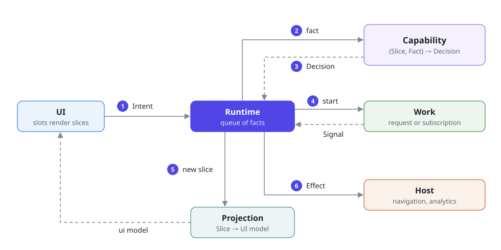
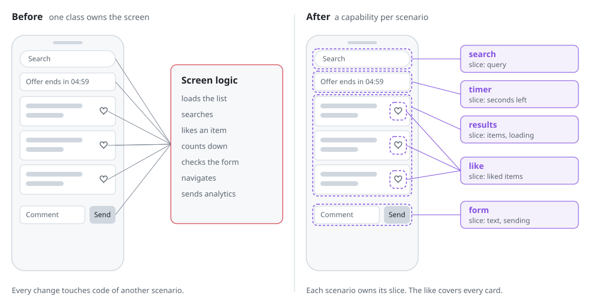

# 🍰 Capability Slice Architecture

<p align="center">
  <a href="LICENSE"></a>
  <a href="https://github.com/MairwunNx/Capsa"></a>
  
</p>

🍰 **Capability Slice Architecture** (CSA) is an architecture for client apps with declarative UI: Compose, Compose Multiplatform, SwiftUI, Avalonia.FuncUI. You cut a screen into small capabilities, one per user scenario, and each capability owns its own slice of state.

[Русская версия](README.RU.md)

A fact enters the runtime, a capability decides what it means for its slice, and the runtime carries out the rest: it stores the new slice, runs the work, and hands the effects to the host.

<picture>
  <source media="(prefers-color-scheme: dark)" srcset="docs/images/flow-dark.svg">
  
</picture>

A screen stops being one big class. Each scenario becomes its own capability with its own slice, and the UI renders the slices side by side.

<picture>
  <source media="(prefers-color-scheme: dark)" srcset="docs/images/screen-split-dark.svg">
  
</picture>

## What you get

- ✏️ **A scenario changes in one place.** The like, the search, and the timer each live in their own capability, so a change to one never touches the code of another.
- ⏳ **Async work is data, and it cancels itself.** A capability returns a work with a key and a policy. The runtime runs it, cancels the stale request on the second tap, and drops its late answer.
- 🚪 **Side effects leave through one door.** Navigation, snackbars, and analytics leave the logic as effects, and only the host performs them.
- 🧪 **You test logic without UI.** A capability is a pure function of a slice and a fact. A test sends facts and checks the slice and the effects: no emulator, no mocked framework.
- 🛡️ **A new fact can’t break a neighbour.** Each capability declares the facts it handles, and the runtime never delivers the rest.
- 🤖 **Agents follow the rules.** The rules are short and formal, so an AI agent writes a capability that fits, and a review checks it rule by rule.

## Five rules

| # | Rule | What it means |
|---|---|---|
| 1 | **Slice by scenario** | A capability owns a user scenario: a like, a search, a timer. Never a layout block. |
| 2 | **The host assembles, it doesn’t think** | The UI entry point collects slices, sends intents, and performs effects. It holds no product conditions. |
| 3 | **The runtime is the only bus** | A capability never imports another one or reads its slice. They talk through facts. |
| 4 | **Side effects live at the edge** | The logic describes navigation, snackbars, and analytics as effects, and the host performs them. The router and the snackbar themselves never get into the logic. |
| 5 | **Keep the decider small** | About 150 lines or 12 facts. Past that, split the capability. |

## One capability, one test

A like shows at once, saves in the background, and rolls back when the save fails. The example uses [Capsa](https://github.com/MairwunNx/Capsa), the Kotlin implementation of CSA.

`LikeSlice.kt` – the state of the scenario:

```kotlin
data class LikeSlice(val liked: Boolean = false, val likes: Int = 0)
```

`LikeFacts.kt` – what comes into the capability and what leaves it:

```kotlin
data object LikeClicked : Intent
data class LikeSaved(val likes: Int) : Signal
data object LikeFailed : Signal
data object ShowLikeError : Effect
```

`LikeApi.kt` – the port the work calls the network through:

```kotlin
fun interface LikeApi {
    suspend fun setLiked(liked: Boolean): Int
}
```

`Likes.kt` – the capability itself:

```kotlin
private val save = WorkKey("save")

fun likes(api: LikeApi) = capability("likes", LikeSlice()) {
    on<LikeClicked> { state, _ ->
        val liked = !state.liked
        // The heart turns red at once. The request is only described here, the runtime runs it.
        state.copy(liked = liked, likes = state.likes + if (liked) 1 else -1).commit(
            work(save, onError = { LikeFailed }) { LikeSaved(api.setLiked(liked)) },
        )
    }
    on<LikeSaved> { state, fact -> state.copy(likes = fact.likes).commit() }
    on<LikeFailed> { state, _ ->
        state.copy(liked = !state.liked, likes = state.likes + if (state.liked) -1 else 1).commit(ShowLikeError)
    }
}
```

The capability never calls the network itself. It returns a work, and the runtime runs it and turns the answer or the error into a signal. So the test drives a real runtime on virtual time with a fake API, without a device or a mock framework.

`LikesTest.kt`:

```kotlin
@Test
fun `a failed save rolls the like back`() = runTest {
    val likes = likes(api = { error("offline") })
    val harness = capsaHarness(likes)

    harness.append(LikeClicked)
    harness.runCurrent()

    assertEquals(LikeSlice(liked = false, likes = 0), harness.stateOf(likes))
    assertEquals(listOf(ShowLikeError), harness.effects)
}
```

## Implementations

| Implementation | Platforms | Status |
|---|---|---|
| 📦 [Capsa](https://github.com/MairwunNx/Capsa) | Kotlin Multiplatform: Android, iOS, and the JVM, with Compose Multiplatform | 0.99 preview |
| F# and Avalonia.FuncUI | .NET desktop | Planned |
| Swift and SwiftUI | iOS and macOS | Planned |

Every implementation gives the same guarantees: one queue of facts, stale signals dropped, each effect delivered once. The [Implementations](https://github.com/MairwunNx/Capability-Slice-Architecture/wiki/Implementations) page lists them all.

## Inspired by

CSA grows from [Feature-Action Architecture](https://github.com/MairwunNx/Feature-Action-Architecture), my architecture for backends. FAA slices a backend by domain and makes every action explicit. CSA brings the same idea to client apps, where state lives on the screen and the UI redraws from it.

## Documentation

The [wiki](https://github.com/MairwunNx/Capability-Slice-Architecture/wiki) holds the specification:

- [Why](https://github.com/MairwunNx/Capability-Slice-Architecture/wiki/Why): the pain of one big view model, and what CSA changes.
- [Vocabulary](https://github.com/MairwunNx/Capability-Slice-Architecture/wiki/Vocabulary) and [Five rules](https://github.com/MairwunNx/Capability-Slice-Architecture/wiki/Five-rules): every term, and every rule with a broken and a fixed example.
- [Data flow](https://github.com/MairwunNx/Capability-Slice-Architecture/wiki/Data-flow), [Work as data](https://github.com/MairwunNx/Capability-Slice-Architecture/wiki/Work-as-data), and [Effects](https://github.com/MairwunNx/Capability-Slice-Architecture/wiki/Effects): one pass of a fact, keys and policies, the one door out.
- [Projections](https://github.com/MairwunNx/Capability-Slice-Architecture/wiki/Projections), [Boundaries](https://github.com/MairwunNx/Capability-Slice-Architecture/wiki/Boundaries), and [Structure](https://github.com/MairwunNx/Capability-Slice-Architecture/wiki/Structure): from slice to UI model, ports and wiring, the packages of a screen.
- [Testing](https://github.com/MairwunNx/Capability-Slice-Architecture/wiki/Testing): what to test, and how without UI.
- [Comparison](https://github.com/MairwunNx/Capability-Slice-Architecture/wiki/Comparison) and [Tradeoffs](https://github.com/MairwunNx/Capability-Slice-Architecture/wiki/Tradeoffs): CSA next to MVVM, MVI, TCA, and Elm, and what CSA doesn’t solve.

## Related projects

- **[Capsa](https://github.com/MairwunNx/Capsa)** – the Kotlin Multiplatform implementation of CSA.
- **[Feature-Action Architecture](https://github.com/MairwunNx/Feature-Action-Architecture)** – my architecture for backends, with the same instinct: slice by domain, one function per job.

> 🫡 Made by Pavel Erokhin (Павел Ерохин), aka mairwunnx.
